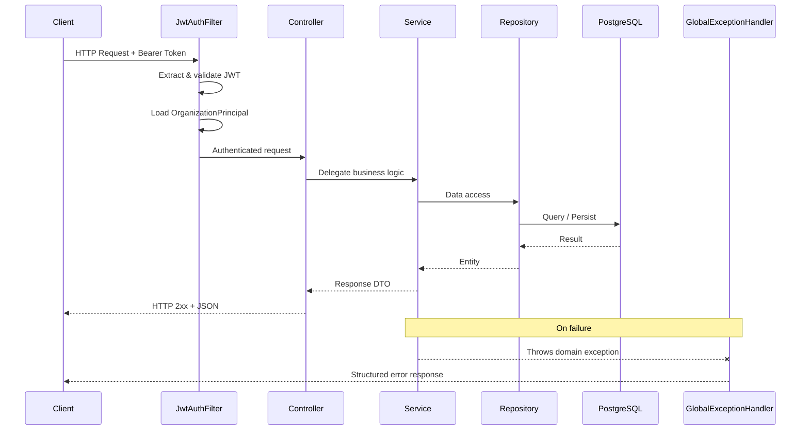

# 🎓 Certificate Generation System

A multi-tenant backend system for issuing, managing, and publicly verifying digital certificates — built with **Spring Boot 3.4**, **Spring Security (JWT)**, **PostgreSQL**, and **OpenPDF**.

Organizations register, define courses with eligibility rules, enroll recipients, assign signatories, and generate branded PDF certificates — all through a secured REST API.

---

## System Architecture


---

## Request Lifecycle

Every API call flows through a consistent layered pipeline:



---

## Domain Model


---

## Security Architecture


**Key security decisions:**

| Aspect | Implementation |
|---|---|
| Identity source | JWT principal (no `X-Org-Id` header spoofing) |
| Token type | Access + Refresh token pair |
| Session control | `currentAuthSessionId` invalidates old tokens |
| Password storage | BCrypt hashing |
| Tenant isolation | All queries scoped by `orgId` from JWT |

---

## Package Structure

```
src/main/java/com/niranjan/certificates/
├── CertificatesGenerationApplication.java    # Spring Boot entry point
├── controller/
│   ├── AuthController.java                   # Login, register, refresh
│   ├── OrganizationController.java           # Org profile & logo
│   ├── CourseController.java                 # Course CRUD
│   ├── RecipientController.java              # Recipient CRUD
│   ├── SignatoryController.java              # Signatory CRUD + signature upload
│   └── CertificateController.java           # Generate, list, download, verify
├── dto/
│   ├── request/                              # Validated input payloads
│   │   ├── LoginRequest, RegisterRequest
│   │   ├── CourseRequest, RecipientRequest
│   │   ├── CertificateRequest, SignatoryRequest
│   │   ├── UpdateOrgRequest, ListQuery
│   │   └── RefreshTokenRequest
│   └── response/                             # Output payloads
│       ├── AuthResponse, OrganizationResponse
│       ├── CourseResponse, RecipientResponse
│       ├── CertificateResponse, SignatoryResponse
│       ├── VerifyResponse, PageResponse
│       └── ...
├── entity/
│   ├── Organization.java                     # Tenant root entity
│   ├── Course.java                           # Course with minScore eligibility
│   ├── Recipient.java                        # Enrolled learner
│   ├── Signatory.java                        # Certificate signer
│   ├── Certificate.java                      # Issued certificate
│   └── CertificateStatus.java               # ISSUED / REVOKED enum
├── exception/
│   ├── GlobalExceptionHandler.java           # Centralized error responses
│   ├── ResourceNotFoundException.java
│   ├── DuplicateResourceException.java
│   └── IneligibleRecipientException.java
├── repository/
│   ├── OrganizationRepository.java
│   ├── CourseRepository.java
│   ├── RecipientRepository.java
│   ├── SignatoryRepository.java
│   └── CertificateRepository.java
├── security/
│   ├── SecurityConfig.java                   # Filter chain & endpoint rules
│   ├── JwtAuthenticationFilter.java          # Per-request token validation
│   ├── JwtService.java                       # Token creation & parsing
│   ├── AuthSessionService.java               # Refresh token rotation
│   ├── OrganizationPrincipal.java            # Authenticated identity
│   └── OrganizationUserDetailsService.java   # UserDetailsService impl
└── service/
    ├── CertificateService.java               # Interface
    ├── CourseService.java
    ├── RecipientService.java
    ├── SignatoryService.java
    ├── OrganizationService.java
    ├── PdfService.java
    ├── ImageService.java
    ├── FileStorageService.java
    └── impl/
        ├── CertificateServiceImpl.java       # Core cert logic + PDF orchestration
        ├── CourseServiceImpl.java             # Soft delete, minScore defaults
        ├── RecipientServiceImpl.java          # Post-issuance guards
        ├── SignatoryServiceImpl.java          # Default signatory management
        ├── OrganizationServiceImpl.java       # Profile & logo management
        ├── PdfServiceImpl.java               # OpenPDF rendering engine
        ├── ImageServiceImpl.java             # PDF-to-image conversion
        └── FileStorageServiceImpl.java       # Local disk I/O
```

---

## Tech Stack

| Layer | Technology |
|---|---|
| **Language** | Java 21 |
| **Framework** | Spring Boot 3.4.5 |
| **Web** | Spring Web (REST) |
| **Security** | Spring Security + JWT (`jjwt 0.12.6`) |
| **Persistence** | Spring Data JPA / Hibernate |
| **Database** | PostgreSQL |
| **Validation** | Jakarta Bean Validation |
| **PDF Generation** | OpenPDF 1.3.30 |
| **PDF Imaging** | Apache PDFBox 3.0.3 |
| **Boilerplate** | Lombok |
| **Build** | Maven |
| **Testing** | JUnit 5 + Mockito |

---

## API Overview

### Public Endpoints

| Method | Endpoint | Description |
|---|---|---|
| `POST` | `/api/org/register` | Register a new organization |
| `POST` | `/api/auth/login` | Authenticate and receive tokens |
| `POST` | `/api/auth/refresh` | Rotate refresh token |
| `GET` | `/api/verify/{uniqueCode}` | Publicly verify a certificate |

### Protected Endpoints (Bearer token required)

| Resource | Endpoints | Operations |
|---|---|---|
| **Organization** | `/api/org/*` | Get profile, update, upload logo |
| **Courses** | `/api/courses/*` | CRUD + soft delete |
| **Recipients** | `/api/recipients/*` | CRUD with post-issuance guards |
| **Signatories** | `/api/signatories/*` | CRUD + set default + upload signature |
| **Certificates** | `/api/certificates/*` | Generate, list, get, download PDF |

---

## Business Rules

### Certificate Issuance Guards
- Recipient and signatory must belong to the authenticated organization
- Recipient's course must be **active**
- Recipient's score must meet or exceed the course `minScore`
- Only **one certificate per organization–recipient pair** (enforced in code + DB constraint)
- Failed DB writes trigger best-effort PDF cleanup

### Recipient Protection
- Course cannot be changed after a certificate has been issued
- Recipient cannot be deleted after a certificate has been issued
- Course must be active at the time of creation or update

### Course Lifecycle
- Courses are **soft-deleted** (marked inactive) to preserve historical certificates
- `minScore` defaults to `0` when omitted; validated in range `[0, 100]`

---

## Error Handling

All errors are normalized through `GlobalExceptionHandler` into a consistent response shape:

```json
{
  "status": 404,
  "message": "Resource not found",
  "timestamp": "2026-04-26T00:30:00"
}
```

| Status | Meaning |
|---|---|
| `400` | Validation error or illegal operation |
| `401` | Missing / expired / invalid token |
| `403` | Not authorized to access resource |
| `404` | Resource not found |
| `409` | Duplicate certificate |
| `422` | Recipient score below course minimum |
| `500` | Unexpected server error |

---

## Design Decisions

| Decision | Choice | Rationale |
|---|---|---|
| Multi-tenancy | Org ID from JWT, query-scoped | Prevents cross-tenant data leaks |
| Primary keys | UUID | Non-sequential, safe for public URLs |
| Service pattern | Interface + Impl | Thin controllers, testable business logic |
| PDF engine | OpenPDF | Lightweight, no external service dependency |
| File storage | Local disk `/uploads` | Simple for MVP, swappable to S3 later |
| Course deletion | Soft delete | Preserves certificate history |
| Certificate uniqueness | One per org–recipient | Prevents accidental duplicate issuance |
| DI style | Constructor injection (Lombok) | Immutable, testable dependencies |
